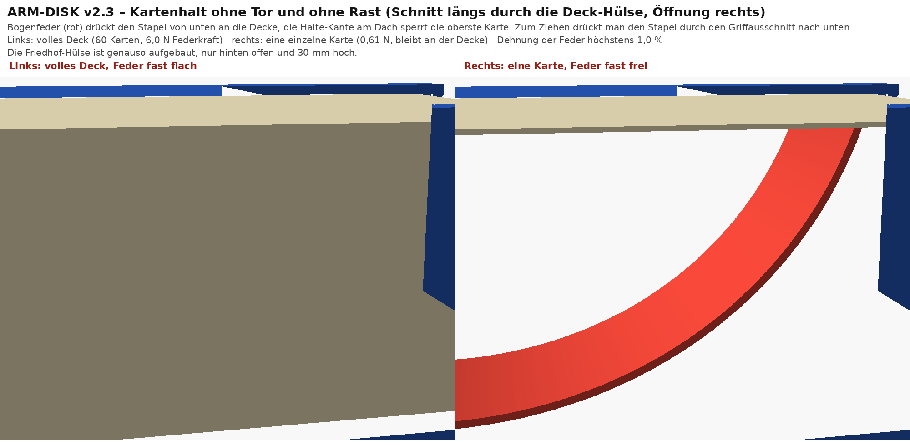

# ARM-DISK v2.3 – Deck und Friedhof halten in jeder Lage (ohne Tor, ohne Rast)

Parametrischer FreeCAD-Master: `build_arm_disk_v2_3.py` → `ARM-DISK_v2.3.FCStd` (Tabelle `Params`), `stls/` (Druckorientierung), `stl_world/` (Einbaulage).
Prüfung: `freecadcmd verify_arm_disk_v2_3.py` → **467/467 bestanden** (gespiegelt für den rechten Arm ebenfalls 467/467). Überhang: **0 mm² ungestützt, 0 Inseln bei allen 17 STL**.

**Gesamtmaße: 363,6 x 240,0 x 67,8 mm** (wie v2.2, die Hülsen sind 4 mm höher wegen der Halte-Kante).

## Neu in v2.3: Karten fallen nicht heraus – auch nicht kopfüber oder beim Schwingen
v2.2 hat nur Lippe und Klemmrippen. Die halten bei leichter Neigung, aber nicht kopfüber und nicht beim Schwingen. v2.3 hält das Deck und den Friedhof **in jeder Lage**, ohne Tor und ohne Rastnase.

**Konzept (wie vorgeschlagen, etwas verfeinert):**
1. **Bogenfeder** (eigenes Teil, `card_spring.stl`, 2 Stück) auf dem Hülsenboden. Sie drückt den Stapel von unten an die Decke. Das gilt für den vollen Stapel und für die letzte einzelne Karte.
2. **Halte-Kante** 2 mm am Deckenrand der Öffnung. Die obersten Karten sitzen dahinter und können nicht herausrutschen.
3. **Bedienung:** Durch den Griffausschnitt den Stapel nach unten drücken (unter die Kante), dann die Karte herausziehen. Beim Loslassen schiebt die Feder den Rest wieder hoch.
4. **Bodenlippe** 1,5 mm bleibt: Wenn man ganz runterdrückt, hält sie die unterste Karte.
5. Die Klemmrippen aus v2.2 bleiben als zusätzlicher leichter Widerstand.

Es gibt kein Tor und keine Rast. Die Feder ist eine **gedruckte Biegefeder** (Dehnung ≤ 1 %), die Hülse und die Feder werden nur geklebt.

## Die Bogenfeder (Rollfeder)
- Maße: Dicke 1,2 mm, Breite 28 mm, Bogen R60, Länge 82 mm, Fuß 8 mm. Freie Höhe der Spitze 47,9 mm.
- Einbau: Fuß am **geschlossenen** Ende einkleben (0,2 mm Klebespalt). Die Spitze zeigt zur Öffnung und liegt unter dem Griffausschnitt, genau dort, wo man drückt.
- Druck: **auf der Seite** (Biegung entlang der Bahnen). So bleibt die Dehnung 1,0 % auch beim Flachdrücken (t/2R = 1,2/(2·60)).
- Kräfte (Elastica-Rechnung, PLA E = 3500 MPa, Annahme ±30 %):

| Zustand | Federhöhe | Kraft | Gewicht | Vielfaches |
|---|---|---|---|---|
| Deck leer (1 Karte) | 44,3 mm | **0,61 N** | 0,026 N | ×23 |
| Deck voll (60 Karten ≈ 162 g) | 4,3 mm | **6,0 N** | 1,59 N | ×3,8 |
| Zum Ziehen ganz runterdrücken | 1,8 mm | **9,3 N** | – | Daumen, geht |
| Friedhof leer | 34,3 mm | 1,79 N | 0,026 N | ×68 |
| Friedhof voll (45 Karten) | 4,3 mm | 6,0 N | 1,19 N | ×5,1 |

×3,8 am vollen Deck heißt: Der Stapel bleibt an der Decke bis etwa 3,8 g Beschleunigung (kräftiger Armschwung). Die Halte-Kante sperrt dann geometrisch. Die Kraft zum Drücken (9,3 N ≈ 950 g) ist mit dem Daumen noch angenehm.

Die Feder liegt in einem Kanal zwischen zwei 3 mm hohen Schienen. Der Federweg reicht von frei (47,9) über leer und voll bis ganz flach (1,8). Die Spitze bleibt immer vor der Bodenlippe und unter dem Dach.

## Was sich an den Hülsen geändert hat
- Schienen 3 mm hoch auf dem Boden, Federkanal und Klebesitz für den Federfuß.
- Halte-Kante 2 mm am Deckenrand (Innenflanke 40° zur Senkrechten beim stehenden Druck, außen steiler, stützfrei).
- Innenraum 0,5 mm höher, damit die Kante über dem Stapel Platz hat.
- Griffausschnitt, Maße, Öffnungsrichtung und Klebefugen wie in v2.2.

## Was gegenüber v2.2 neu gedruckt werden muss
| neu drucken | Grund |
|---|---|
| `deck_pocket.stl` | Schienen, Federkanal, Halte-Kante |
| `gy_pocket.stl` | dasselbe |
| `card_spring.stl` (2×) | neu (Deck + Friedhof) |

**Unverändert, nicht neu drucken:** `disc_shell`, `backbone_A`, `backbone_B`, `arm_tile`, `bay`, `bay_lid`, `pin` und alle `v28_*.stl`.

## Teile und Druckorientierung
| Teil | Datei | Maß (mm) | Lage auf dem Bett |
|---|---|---|---|
| Deck-Hülse | `deck_pocket.stl` | 73,3 x 99,4 x 52,6 | stehend, geschlossene Stirnseite unten |
| Friedhof-Hülse | `gy_pocket.stl` | 73,3 x 99,4 x 42,6 | stehend, geschlossene Stirnseite unten |
| Bogenfeder | `card_spring.stl` | 28 x ≈90 x 5,4 (frei) | **auf der Seite** (Dicke 1,2 auf dem Bett) |
| übrige Teile | | | wie v2.2 |

## Cura-Einstellungen (Ender / Vyper, Düse 0,4)
| Cura (deutsch) | Cura (englisch) | Wert |
|---|---|---|
| Schichtdicke | Layer Height | 0,2 mm |
| Wanddicke / Anzahl der Wandlinien | Wall Thickness / Wall Line Count | 1,2 mm / 3 (Feder: 100 % Infill oder 4 Wandlinien) |
| Obere/untere Dicke | Top/Bottom Thickness | 0,8 mm |
| Fülldichte | Infill Density | 15 % (Hülsen 20 %, Feder 100 %) |
| Stützstruktur erzeugen | Generate Support | **aus** |
| Druckplattenhaftungstyp | Build Plate Adhesion Type | Hülsen: **Brim** 5 mm; Feder: Brim 3 mm |
| Horizontale Erweiterung | Horizontal Expansion | 0 |
| Kompensation horizontaler Löcher | Hole Horizontal Expansion | 0 |

**Einbau:** Federfuß in den Klebesitz am geschlossenen Ende einkleben (Spitze zeigt zur Öffnung). Dann die Hülse auf den Träger kleben wie in v2.2. Gurt A vorher durch den Tunnel ziehen.

## Kompromisse / offen
- Die Federkräfte kommen aus einer Elastica-Rechnung mit E = 3500 MPa (PLA). Am Druck kann die Kraft ±30 % abweichen. Zu weich: `sp_b` erhöhen (z. B. 32). Zu hart: `sp_b` senken (24) oder `sp_R` auf 65.
- 9,3 N zum Drücken ist für den Daumen machbar, aber spürbar. Wenn es zu schwer ist: `sp_b` 24.
- Länge, Oberarm-Anstoß und Friedhof-Öffnung zum Körper: unverändert zu v2.2.
- Weiter offen: Drehteller nur für Karten ohne Sleeve; Stiftleisten der Platine nach oben angenommen.
